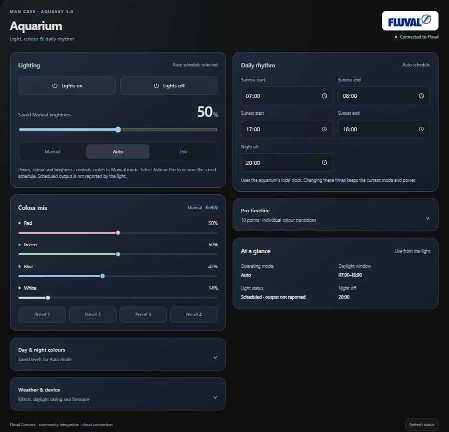
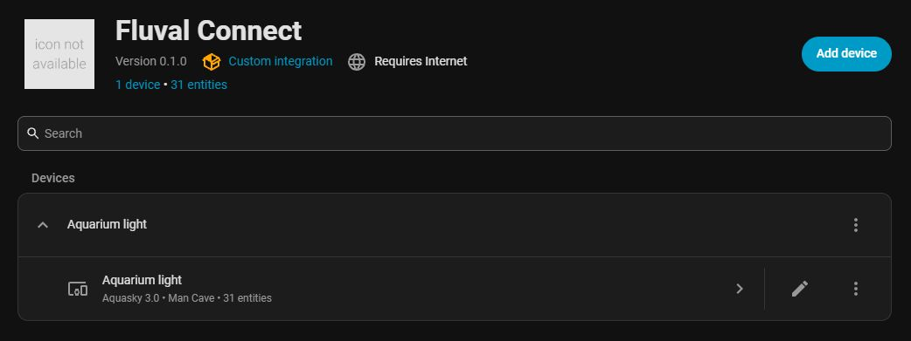

# Fluval Connect for Home Assistant

Community integration and aquarium dashboard card for the **Wi-Fi Aquasky 3.0**, tested with firmware 10 in the UK/EU cloud region. This is an independent project and is not affiliated with Fluval or Hagen.

**Experimental, advanced setup:** a working, authorized Fluval cloud connection profile is required. The project does not distribute manufacturer signing credentials or provide a way to obtain them. A Fluval account password alone is insufficient for a new installation. Other models, Bluetooth-only lights and other cloud regions are untested.

**HACS catalogue status:** the [default catalogue submission](https://github.com/hacs/default/pull/12985) needs changes because there is no verified way for an ordinary owner to obtain the required connection profile. Until that is resolved, this remains a custom-repository integration for owners who already have a working authorized profile. Installing the files does not remove this prerequisite.

## Screenshots

Aquarium management: Fluval lighting, RGBW channels and saved schedules. Temperature and reservoir cards are excluded.



Home Assistant integration overview from the existing personal installation. Its legacy version label is not the current public release number; it does not demonstrate a new-user setup.



## Controls

- Power and RGBW brightness, Manual / Auto / Pro modes.
- Twelve individual Manual, daytime and nighttime colour controls.
- Sunrise and sunset start/end, night-off time, complete 2–12 point Pro timeline.
- Four saved colour presets, numbered weather effects and daylight saving.
- Firmware, device clock, Auto and Pro schedule readouts, read-only scheduled weather.
- Branded dark dashboard card with compact pastel panels and a responsive layout.

Power on/off is an explicit **Manual override**. Manual colour, brightness, preset and weather changes also select Manual mode. Select Auto or Pro to resume the light's saved schedule. Editing Auto or Pro schedules preserves mode and power. Commands wait up to 15 seconds for matching device reports. Clock/timezone, reset and firmware update commands are not exposed. A response confirms the device's reported setting, not independent measurement of emitted light.

The Wi-Fi protocol exposes saved Manual power and RGBW settings; these are **not live output measurements in Auto/Pro**. In scheduled modes the light entity reports an unknown output state, while remaining available for control; the card shows the selected schedule and labels Manual brightness separately. It does not invent a measured brightness from the schedule.

The ticking Device clock sensor is an optional diagnostic, disabled by default for new installations. Existing users can disable it under the entity's settings to stop new minute-by-minute Activity/Recorder entries. This does not stop the light's internal clock or its schedules. Clock ticks no longer refresh the card's editor. Previously recorded activity remains in Home Assistant's history.

## Install

Requires Home Assistant 2026.3 or newer and internet access to the Fluval EU cloud. This uses MQTT over TLS; it is **not local Wi-Fi control**.

### Connection profile prerequisite — read before downloading

The profile contains the broker instance ID, access key and signing key for the Fluval cloud broker. These are separate from your Fluval account email/password and from your home Wi-Fi credentials. Running your own MQTT broker or creating an unrelated Alibaba Cloud account does not supply access to the broker used by the light.

The currently supported source is a **working authorized profile you already possess**, including a private profile from an existing personal installation. Account sign-in in this integration discovers the owner's lights; it does not provision broker credentials. This project has not verified a self-service vendor portal, app export or account-only API that provides an owner with a new working profile. There are therefore no complete new-owner provisioning steps to document at present. If you do not already have a profile, stop here: this release cannot complete setup with your account password alone.

For an existing version 1 installation:

1. Back up Home Assistant.
2. Privately copy its working `_private_cloud.json` **outside** the integration folder to `/config/fluval_connect_private.json` before replacing any files. Keep the backup out of public repositories and issue reports.
3. Install the update and restart Home Assistant. The existing configuration entry migrates its selected device's profile; there is no need to create a duplicate entry.

This migration preserves an existing working installation. It does not create credentials for a new owner. Default-catalogue eligibility requires a verified owner-accessible provisioning procedure or a tested account-only setup flow first.

### Download and configure

**Once accepted into the default HACS catalogue:** search for **Fluval Connect** in HACS and download it. It is **not currently listed**; the custom-repository route below is the available alternative for users who meet the profile prerequisite.

1. In HACS, open **Custom repositories**, add `https://github.com/koxy333/fluval-connect` with category **Integration**, and download Fluval Connect. For a manual installation, copy `custom_components/fluval_connect` into your Home Assistant `custom_components` directory.
2. Restart Home Assistant.
3. Under **Settings → Devices & services → Add integration**, select **Fluval Connect**.
4. Supply your authorized broker instance ID, access key and signing key. These remain in Home Assistant's configuration entry and must be treated as secrets.
5. Sign into your Fluval account to verify ownership, then select your light. The password and sign-in token are used transiently and are not saved. Fluval may sign the phone app out when a new session starts. Setup performs a read-only connectivity check.

HACS custom repository installation is separate from inclusion in the default HACS catalogue. Catalogue availability is subject to HACS review.

## Dashboard card

The integration loads the card automatically. After installation, refresh your browser. Add a manual card:

```yaml
type: custom:fluval-connect-card
name: Aquarium light
title: Aquarium
location: Aquarium
device_id: YOUR_HOME_ASSISTANT_DEVICE_ID
```

`name` must match the Home Assistant device/entity naming prefix; `device_id` is the Home Assistant device ID, not the MAC. A panel view gives the card room to display both columns. The Pro editor keeps a local draft until **Save timeline**; **Cancel** sends nothing. Advanced colour and weather controls are folded away.

For a standalone card installation, copy `frontend/fluval-connect-card.js` from the integration directory into `/config/www`, then add `/local/fluval-connect-card.js` as a JavaScript module dashboard resource. Use one loading method; remove any old manually registered card resource before switching to the integration's automatic loading.

## Actions

`fluval_connect.set_pro_schedule` accepts a Home Assistant `device_id` and `points`, each containing `time` (`HH:MM`) and integer `red`, `green`, `blue`, `white` percentages. Supply the whole timeline with strictly increasing times.

`fluval_connect.set_auto_schedule` accepts `device_id` and `schedule`: `sunrise_start`, `sunrise_end`, `sunset_start`, `sunset_end`, `night_off` (null disables it), and `day` / `night` objects with the same four colour percentages.

## Validation and limitations

Run `python -m unittest discover -s tests -v` and `node --test tests/card.test.cjs`. GitHub Actions also runs HACS validation and Home Assistant hassfest. Tests use synthetic device identifiers, a minimal Home Assistant entity surface and mocked transport; they do not control an aquarium. Regression coverage includes scheduled output versus Manual settings, explicit Manual power overrides, mode-only Auto selection and clock-driven card refreshes. The dashboard has been visually checked in Home Assistant, including narrow layouts, refresh, Pro draft editing and cancellation. Expanded writes have offline protocol and service-dispatch tests; physical validation of every control is still outstanding.

If the light is unavailable, verify Wi-Fi in FluvalConnect, internet access and the selected cloud region. An Espressif router entry alone does not establish device identity. Report issues without credentials, tokens or full diagnostics containing private connection information.

## Attribution

Code is MIT licensed. Fluval names and logos belong to their respective owners and are used to identify the supported product; they are not covered by the code's MIT licence. The wordmark source is [Fluval aquarium on Seeklogo](https://seeklogo.com/vector-logo/521543/fluval-aquarium); the integration icon identifies the FluvalConnect app.
